  

  <picture>
    <source media="(prefers-color-scheme: dark)" srcset="assets/typing-dark.svg">
    
  </picture>

  <a href="https://bw.tech"><picture><source media="(prefers-color-scheme: dark)" srcset="assets/btn-website-dark.svg"></picture></a>
  <a href="https://bw.tech/loesungen/cloud-by-design/"><picture><source media="(prefers-color-scheme: dark)" srcset="assets/btn-loesungen-dark.svg"></picture></a>
  <a href="https://bw.tech/kontakt/"><picture><source media="(prefers-color-scheme: dark)" srcset="assets/btn-kontakt-dark.svg"></picture></a>
  <a href="https://bw.tech/ueber-uns/#stellenAnzeigen"><picture><source media="(prefers-color-scheme: dark)" srcset="assets/btn-karriere-dark.svg"></picture></a>

 

Hinter **BW.Tech** stehen Menschen, die zuhören, ehrlich beraten und gemeinsam mit Ihnen anpacken – seit 2008. Als Beratungs- und Softwareunternehmen entwickeln wir maßgeschneiderte Cloud-Lösungen, sichern Ihre Daten und betreuen Ihre Systeme im Hochverfügbarkeits-Rechenzentrum in Deutschland. Uns ist der kollegiale Umgang auf Augenhöhe wichtig – Ihre Anforderungen stehen bei uns im Mittelpunkt.

> Mit BW.Tech erhalten Sie nicht nur die Lösung, die Sie wollen – sondern die, die Sie brauchen.

 

## Unsere Lösungen

  <a href="https://bw.tech/loesungen/cloud-by-design/"><picture><source media="(prefers-color-scheme: dark)" srcset="assets/card-cloud-dark.svg"></picture></a>
  <a href="https://bw.tech/loesungen/backup/"><picture><source media="(prefers-color-scheme: dark)" srcset="assets/card-backup-dark.svg"></picture></a>
  <a href="https://bw.tech/loesungen/softwareentwicklung/"><picture><source media="(prefers-color-scheme: dark)" srcset="assets/card-software-dark.svg"></picture></a>
  <a href="https://bw.tech/loesungen/it-komplettloesungen/"><picture><source media="(prefers-color-scheme: dark)" srcset="assets/card-it-dark.svg"></picture></a>
  <a href="https://bw.tech/loesungen/ihre-sichere-cloud-managed-services-im-rechenzentrum/"><picture><source media="(prefers-color-scheme: dark)" srcset="assets/card-managed-dark.svg"></picture></a>
  <a href="https://bw.tech/loesungen/ki-hosting/"><picture><source media="(prefers-color-scheme: dark)" srcset="assets/card-ai-dark.svg"></picture></a>

 

## Über BW.Tech

  <a href="https://bw.tech/ueber-uns/">
    <picture>
      <source media="(prefers-color-scheme: dark)" srcset="assets/about-dark.svg">
      
    </picture>
  </a>

 

## Technologien

  <picture>
    <source media="(prefers-color-scheme: dark)" srcset="assets/tech-dark.svg">
    
  </picture>

 

  

